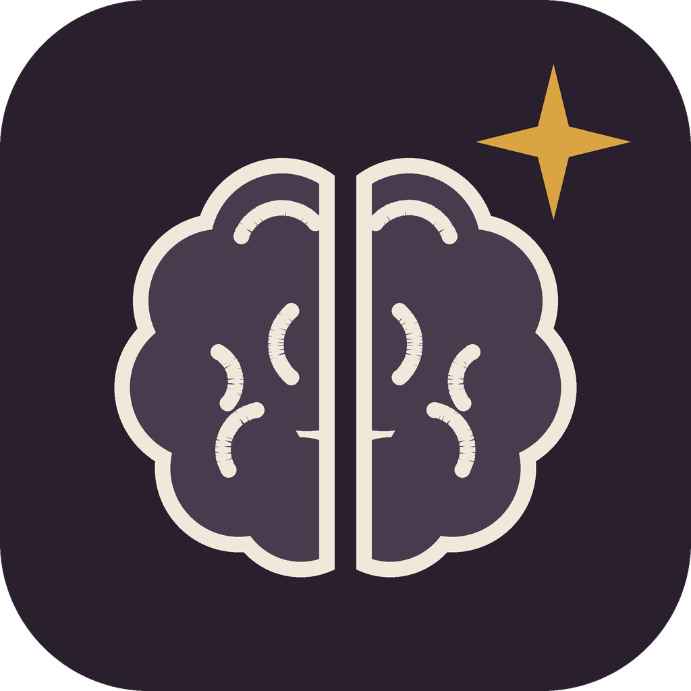

<p align="center">
  
</p>
<p align="center">
  <strong>ADHD'ye uygun Türkçe cevaplar. ADHD tanısı gerekmez!</strong>
</p>
<p align="center">
  <a href="LICENSE"></a>
</p>

[ayghri/i-have-adhd](https://github.com/ayghri/i-have-adhd) skill'inin Türkçe uyarlaması.

## Kurulum

### Claude Code

```bash
claude plugin marketplace add kenosdota/i-have-adhd-tr
claude plugin install i-have-adhd-tr@i-have-adhd-tr
```

Claude Code'u yeniden başlat, sonra `/i-have-adhd-tr` yaz.

Güncellemek için:

```bash
claude plugin marketplace update i-have-adhd-tr
claude plugin update i-have-adhd-tr@i-have-adhd-tr
```

Kaldırmak için:

```bash
claude plugin uninstall i-have-adhd-tr
claude plugin marketplace remove i-have-adhd-tr
```

### Claude, ChatGPT ve Gemini uygulamaları

Bu uygulamalar SKILL.md dosyası içeren skill klasörlerini kabul ediyor. [Sürümler sayfasından](https://github.com/kenosdota/i-have-adhd-tr/releases/latest) `i-have-adhd-tr.zip` dosyasını indir ve uygulamanın skill bölümünden yükle:

- Claude: [Claude'da skill kullanımı](https://support.claude.com/en/articles/12512180-using-skills-in-claude)
- ChatGPT: [ChatGPT Skills](https://help.openai.com/articles/20001066) (yalnızca bazı planlarda var)
- Gemini: [Gems'ten skill'lere geçiş](https://support.google.com/gemini/answer/18560919)

Bu uygulamalarda denenmedi. Skill'in açılıp açılmadığını ilk mesajda kontrol et.

### Kurulumsuz: kopyala-yapıştır istem

Skill kurmak istemiyorsan [PROMPT.md](PROMPT.md) dosyasındaki metni kopyala ve yeni bir sohbetin ilk mesajı olarak yapıştır. Kurulum gerektirmez; metin yapıştırabildiğin her yapay zekâ sohbetinde kullanabilirsin. Sohbet çok uzarsa kurallar unutulabilir; öyle olursa metni yeniden yapıştır.

## Ne yapar

Yapay zekânın cevabı gömmesini engeller. Önce yapılacak iş. Numaralı adımlar. "Umarım yardımcı olmuştur!" yok.

Yalnızca yapay zekânın cevap biçimini değiştirir. ADHD tanısı koymaz, tedavi yerine geçmez.

## Ne değişir

<table>
<tr>
<td width="50%">

## Önce

> Harika soru! Bir bakalım. Giriş akışının birkaç parçası var: ara katman, token doğrulaması ve çerez yönetimi. `src/auth.ts` dosyasına baktığımda `verifyToken` fonksiyonu (yaklaşık 42-58. satırlar) `jsonwebtoken` paketinin eski bir sürümünü kullanıyor gibi görünüyor. Bir yol, paketi güncelleyip fonksiyonu yeniden yazmak olabilir. Değişikliği yaptıktan sonra bir şeyin bozulmadığından emin olmak için giriş testlerini çalıştırmak isteyebilirsin. Bu arada genel olarak paket sürümlerine de bakmak isteyebilirsin. Umarım yardımcı olmuştur! Daha ayrıntılı bakmak istersen söyle.

</td>

<td width="50%">

## Sonra

> Token doğrulamasını güncellemek için `src/auth.ts:42` satırını düzenle.
>
> 1. `src/auth.ts` dosyasını aç
> 2. `verifyToken` fonksiyonunu (42-58. satırlar) aşağıdaki kodla değiştir
> 3. `npm test -- auth.spec.ts` komutunu çalıştır
>
> Sonraki adım: test başarısız olursa ilk hatalı satırı buraya yapıştır.

</td>
</tr>
</table>

## Kurallar

10 kural. Tam metin: [SKILL.md](skills/i-have-adhd-tr/SKILL.md).

1. Önce yapılacak işi söyle.
2. Çok adımlı işi numarala.
3. Tek bir somut sonraki adımla bitir.
4. Konu dışına çıkma.
5. Her mesajda nerede kalındığını yeniden yaz.
6. Somut süre ver (dakika, "biraz" değil).
7. Biten işi görünür kıl.
8. Hataları sakin bir dille söyle.
9. Listeleri 5 maddeyle sınırla.
10. Giriş yok. Özet yok. Kibarlık kapanışı yok.

Kapatmak için: "ADHD modunu kapat" ya da "normal moda dön".

## Orijinalden farkları

- Yasaklı açılış, özet ve kapanış cümleleri, hata ve süre ifadeleri, çekinceler ve deyimler Türkçe karşılıklarıyla yazıldı ("Harika soru!", "Hemen bakayım", "Biraz uğraştırır", "Kolları sıvayalım" gibi).
- "Kolay gelsin" ve "İyi çalışmalar" kapanışta kullanılabilir.
- **Anlamadığında:** Yapay zekâ tahminle cevap vermez. "Şunu anlamadım: ..." der, sonra doğru cevaba götürecek soruları tek tek sorar. En fazla 3 soru sorar; konu daha önce netleşirse durur. Bu kural, orijinaldeki "tek bir netleştirme sorusu sor" kuralının yerine geçer.
- Okura "sen" diye seslenir.
- Türkçe kapama komutları eklendi. İngilizce komutlar da çalışır.
- Orijinaldeki "her oturumda kendiliğinden açılma" betikleri (hook) bu sürümde yok. Sürümde çalıştırılan bir kod yok, yalnızca metin dosyaları var.

## Test sonuçları (orijinal skill)

Aşağıdaki sonuçlar **orijinal İngilizce skill'e** aittir ve [orijinal deponun test raporundan](https://github.com/ayghri/i-have-adhd/blob/main/evals/RESULTS.md) alınmıştır. Türkçe sürüm ayrıca test edilmedi.

| | |
|---|---|
| Tarih | 2 Ağustos 2026 |
| Model | `claude-opus-4-8` |
| Test sorusu | 14 |
| Deneme | Her soru için 3 |
| Hakem | Aynı model, hangi cevabın skill'li olduğunu bilmeden |

Skill'siz cevap ile skill'li cevap, 1-5 arası puanlama:

| Ölçüt | Ağırlık | Skill'siz | Skill'li | Fark |
| --- | ---: | ---: | ---: | ---: |
| Doğruluk | %35 | 4,333 | 4,524 | +0,190 |
| Kendi başına iş görme | %25 | 3,762 | 4,167 | +0,405 |
| Uygulanabilirlik | %20 | 3,905 | 4,619 | +0,714 |
| Güvenlik | %10 | 4,643 | 4,667 | +0,024 |
| Kısalık | %10 | 3,429 | 4,571 | +1,143 |
| **Ağırlıklı** | | **4,045** | **4,473** | **+0,427** |

Skill'li cevaplar 14 sorunun 10'unda kazandı, 2'sinde berabere kaldı, 2'sinde kaybetti. Ciddi hata sayısı skill'siz cevaplarda 7, skill'li cevaplarda 3. Orijinal deponun kendi yayın ölçütü "hiç ciddi hata olmaması"; skill'li sürüm 3 hatayla bu ölçütü geçemedi. Ayrıntılar orijinal raporda.

## Kendine göre ayarla

Depoyu fork'la, `skills/i-have-adhd-tr/SKILL.md` dosyasını düzenle, sonra kendi kopyanı kur:

```bash
claude plugin uninstall i-have-adhd-tr
claude plugin marketplace remove i-have-adhd-tr
claude plugin marketplace add <kullanıcı-adın>/i-have-adhd-tr
claude plugin install i-have-adhd-tr@i-have-adhd-tr
```

Claude Code'u yeniden başlat, sonra `/i-have-adhd-tr` yaz.

## Emeği geçenler

- Orijinal skill: [ayghri/i-have-adhd](https://github.com/ayghri/i-have-adhd), Ayoub Ghriss (MIT).
- Orijinal skill, J. Russell Ramsay ve Anthony L. Rostain'in *The Adult ADHD Tool Kit* kitabından gevşek biçimde yararlanır; kurallar bir insanın gününü düzenlemesine değil, yapay zekânın nasıl cevap vermesi gerektiğine uyarlanmıştır.
- Türkçe uyarlama: [Kenan Efe Genç](https://github.com/kenosdota).

## Lisans

[MIT](LICENSE). Orijinal yazarın telif bildirimi korunmuştur.

Bir "Harika soru!"yu bile atlatmana yaradıysa yıldız ver ⭐
